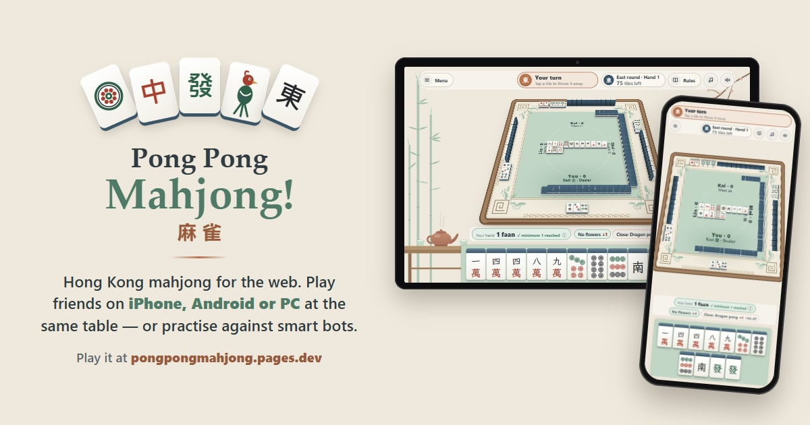

# Pong Pong Mahjong!

[](https://github.com/willsonchen95/pongpongmahjong/actions/workflows/ci.yml)

**Hong Kong mahjong, free in your browser — on iPhone, Android and PC, all playing together.**

### ▶ [Play it at pongpongmahjong.pages.dev](https://pongpongmahjong.pages.dev/)



Share a room code with friends, or practise against bots — even offline. Played for fun: no money,
no betting, no download, no sign-up.

## Features

- **Online rooms with friends** — private rooms joined by a short code; bots fill any empty seats,
  and a player who drops out can reconnect to their seat.
- **Bots at three levels**, plus a guided first game and beginner tips for people new to mahjong.
- **Hong Kong scoring**, with a reveal that shows each faan pattern in turn and lights up the tiles
  that earned it. A *Family style* option drops the points and just asks for a minimum faan.
- **Voice calls** — record your own *Pong!*, *Chi!*, *Kong!* and *Mahjong!* for friends to hear.
- **Your record** — history, best hand and 17 challenges, kept on the device only.
- **English and Bahasa Indonesia**, switchable from the main menu.
- **Installs like an app** (PWA) and plays against the bots with no connection.

## One person, every role

I built Pong Pong Mahjong! on my own, from the first idea to the live site. My background is QA, and
it shaped how the game was built as much as what it does.

- **Product**: what to build and for whom, a guided first game for beginners, a feedback page and
  anonymous play counts, and changing direction when players said something felt wrong
- **Development**: the rules engine, the game screens, and the online room server, in TypeScript
- **DevOps**: Cloudflare Pages, Workers and Durable Objects; a fallback route for networks that block
  the server; rate limiting; offline play; CI on every push
- **QA**: 124 automated tests where bugs cost most, a server that makes cheating impossible by
  design, and real-device testing with friends on a Samsung Galaxy Z Fold 5, friends' phones and
  Chrome on Windows 11

Some bugs only show up with real players:

| What players saw | Root cause | Fix |
|---|---|---|
| Friends' phones stuck on "Connecting…" | Some mobile networks, ad blockers and Private DNS block `workers.dev` | Rooms reached through the site's own address, falling back to `workers.dev` |
| Invite links opened the main menu on Android | Chrome's late install-prompt event redrew the menu over the invite | The prompt no longer redraws the current screen |
| Everyone stuck at "Waiting for others…" | A player who left or went quiet was still waited for | Re-check on leave, deal after 30 s (+ tests) |
| Winning tiles lost to the turn timer | A win shared the Pong/Chi pop-up, and timing out meant passing | Its own pop-up, and timing out takes the win (+ test) |

Feedback changed the game too. Friends said it looked like a slot machine, and some people took the
link for a scam, so version 1.1.0 moved to a calm tea-house look and added a points-free *Family
style*.

**→ The full story, with how each bug was found and how feedback is handled: [TESTING.md](TESTING.md)**

## How it's built

No game framework and no UI library — TypeScript, the DOM and CSS.

| Part | What it does |
|---|---|
| `src/engine.ts` | The rules: the wall, calls (pong, chi, kong), winning hands and faan scoring |
| `src/main.ts`, `src/ui.ts`, `src/table.ts` | The game screens and the table, laid out for phones held either way and for computers |
| `src/online.ts` | The browser side of online play, over WebSockets |
| `server/` | A Cloudflare Worker with a Durable Object per room: it runs the game with the same rules engine as the browser, so every player sees the same table and no one can cheat from their own copy; it also rate-limits connections and messages |
| `functions/` | Cloudflare Pages Functions that pass `/api` and `/rooms` through to the Worker |
| `src/sw.js` | The service worker that makes the game installable and playable offline |

Tested with Vitest (124 tests: the rules engine, the room server, scoring, translations and the record), run on every push by GitHub Actions. See [TESTING.md](TESTING.md).

**Stack:** TypeScript · Vite · Vitest · Cloudflare Pages, Workers and Durable Objects

## Running it locally

```sh
npm install
npm run dev          # the game, at http://localhost:5173
npm run server:dev   # the room server, for online play
npm test             # the tests
```

## Licence

© 2026 Wilson Chen. All rights reserved — the code is here to read, not to reuse; see
[LICENSE](LICENSE). Music: "Moonlit Whispers" by kaazoom (Pixabay). Font: LXGW WenKai TC (SIL OFL 1.1).
